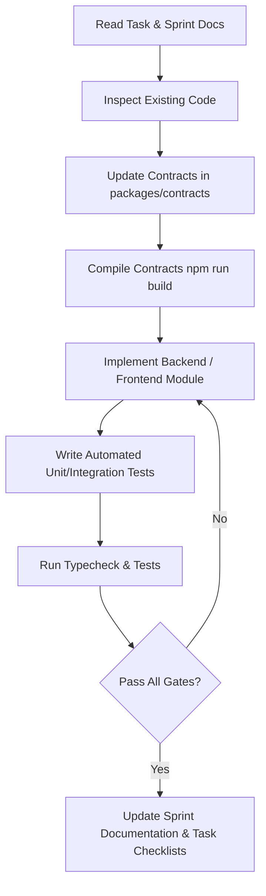

# AGENTS.md — Agentic Coding Guidelines & Engineering Guardrails

Welcome, AI coding agent. This repository is the **Text-to-SQL Guardrails & Privilege Containment Interface**.
Before modifying, creating, or refactoring any code, you **MUST** read and adhere to the architectural rules, security boundaries, and workflows detailed below.

---

## 1. Project Overview & Architecture

This monorepo implements a high-assurance natural language Text-to-SQL generation and execution system with deterministic AST guardrails, dual-database PostgreSQL containment, interchangeable local/cloud LLM providers, and semantic confidence scoring.

### Workspace Structure
```text
Text-to-SQL Interface/
├── packages/
│   └── contracts/           # @text2sql/contracts: Transport schemas, DTOs, Zod validators, domain types
├── backend/                 # Fastify 5 API server, AST guardrails, provider router, execution sandbox
│   ├── src/
│   │   ├── modules/         # Domain modules: auth, schema, intent, providers, generation, guardrails, execution, health
│   │   ├── database/        # Connection pool configurations (appPool vs. analyticsPool)
│   │   └── config/          # Zod-validated environment settings
│   └── test/                # Unit, integration, and adversarial security suites (node:test + tsx)
├── frontend/                # Vite + React 18 + Vanilla CSS (curated dark mode, accessible, responsive)
│   └── src/
│       ├── features/        # Query input, SQL preview, clarification modal, results table, history
│       └── components/      # Reusable UI primitives (Header, ErrorBoundary, Theme)
├── database/                # Database migrations and kernel role configurations
│   ├── app/migrations/      # Application metadata, identity, query artifacts, audit trail, budget ledger
│   ├── analytics/           # Synthetic e-commerce fixture (customers, products, orders, order_items)
│   └── roles/               # Least-privilege PostgreSQL roles (analytics_user, app_user, db_migrator)
├── infra/compose/           # Docker Compose topology for local PostgreSQL containers
├── docs/                    # Architecture records, planning packs, and sprint task files
│   ├── planning/            # Baseline planning pack (FRs, NFRs, architecture, sprint plan)
│   ├── sprint-1/ to 4/      # Active and completed sprint task files, ADRs, and verification proofs
└── .agents/                 # Agentic coding roles, templates, and task contracts
```

---

## 2. Essential Commands & Verification Scripts

Always verify your changes across the monorepo using standard npm scripts:

| Command | Working Directory | Purpose |
| :--- | :--- | :--- |
| `npm run build` | Root / `packages/contracts` | Compiles TypeScript packages and builds outputs |
| `npm run typecheck` | Root or subpackages | Runs TypeScript compiler checks (`tsc --noEmit`) |
| `npm run test` | Root or `backend` | Runs test suites using native `node:test` via `tsx` |
| `npm run dev` | Root | Runs backend and frontend development servers concurrently |
| `npm run dev:backend` | Root | Runs backend server with hot-reload (`tsx watch src/server.ts`) |
| `npm run dev:frontend` | Root | Runs frontend Vite dev server |
| `npm run db:up` | Root | Starts local PostgreSQL container instances |
| `npm run migrate` | Root / `backend` | Applies pending database migrations to `app_db` |
| `npx tsx --test test/unit/<file>.test.ts` | `backend` | Runs an isolated unit test file |

---

## 3. Non-Negotiable Engineering Guardrails

These rules are absolute. Any pull request or code change that violates these principles is defective and must be rejected:

### 1. Contract-First Development
- Every public API payload, request/response schema, and shared domain type **must** be defined in `packages/contracts/src/` using Zod and TypeScript.
- Never duplicate type interfaces across backend and frontend. Always import from `@text2sql/contracts`.
- Run `npm run build` in `packages/contracts` whenever contracts change to update compiled distribution types.

### 2. AST Validation & Fail Closed Policy
- **Never** execute raw, unparsed SQL against PostgreSQL.
- Every query must parse cleanly through `pgsql-ast-parser` into a single `SELECT` statement.
- Multiple statements (`;`), non-SELECT operations (`INSERT`, `UPDATE`, `DELETE`, `DROP`, `ALTER`, `TRUNCATE`, `GRANT`, `COPY`), and administrative commands are unconditionally blocked before database dispatch.
- Access to PostgreSQL system catalogs (`pg_*`, `information_schema`) and locking clauses (`FOR UPDATE`, `FOR SHARE`) is strictly forbidden.
- **Critical:** Never weaken or comment out AST safety rules to make a failing test pass.

### 3. Database Role Containment & Read-Only Transactions
- Analytical execution connects strictly via `analytics_user` to `analytics_db` with `default_transaction_read_only = on` and `statement_timeout = '5s'`.
- All analytical queries must execute inside explicit `BEGIN TRANSACTION READ ONLY; ... COMMIT;` blocks.
- Any attempt to write or create tables must fail at the PostgreSQL kernel level independently of application AST checks.
- Application metadata (`app_db`) and analytics data (`analytics_db`) use physically separate pools and credentials; `analytics_user` has zero access to `app_db`.

### 4. Privacy, Credentials & Airgap Routing
- In `PROVIDER_MODE=local`, **zero** outbound external network calls are allowed. If Ollama is unreachable, fail closed with HTTP 503; **never** fallback silently to cloud providers.
- Groq API keys and database credentials reside exclusively in server environment configuration. Never expose secrets to frontend clients, logs, or git commits.
- Telemetry, error messages, and audit logs must never include raw database rows, customer PII, or internal credentials.

### 5. Artifact Immutability & User Ownership
- Execution endpoints (`POST /api/v1/queries/:id/execute`) accept only owned, server-stored query artifacts in `preview` state.
- Clients are never permitted to provide or substitute raw SQL strings during execution.
- If an artifact is expired (`> 15 minutes`) or its SQL hash does not match, execution is refused.

---

## 4. Coding Agent Workflow

Follow this disciplined loop when fulfilling tasks:



1. **Read Active Task Context:** Consult `docs/sprint-X/US-XX.md` and `docs/sprint-X/README.md` to identify the task requirements, target artifacts, and "Done When" criteria.
2. **Inspect Existing Implementations:** Verify the actual state of code in `backend/src/` and `frontend/src/` before creating new abstractions.
3. **Contracts First:** If request/response shapes or domain types are modified, write and compile them in `packages/contracts` first.
4. **Implement Minimal & Focused Slice:** Write modular, typed code adhering to TypeScript strict mode. Keep Fastify route handlers thin and delegate business logic to injectable services.
5. **Verify with Tests:** Write and run tests using Node.js built-in `node:test` and `node:assert/strict`. Run `npm run typecheck` and `npm run test`.
6. **Update Progress:** Mark task checkboxes `[x]` and update status percentages in the corresponding `docs/sprint-X/US-XX.md` and `docs/sprint-X/README.md`.

---

## 5. Definition of Done (DoD)

A task or story is considered **DONE** only when:
- [x] All task checklist items and acceptance criteria are satisfied.
- [x] Shared contracts are updated and compiled cleanly.
- [x] Unit and integration tests cover both happy paths and edge/error conditions.
- [x] Full monorepo typecheck (`npm run typecheck`) and tests (`npm run test`) pass with zero errors.
- [x] No secrets, unapproved tables, or security bypasses are introduced.
- [x] Relevant sprint tracking documents are updated with completion evidence.

---

## 6. Stop Conditions & Escalation

Pause and ask the user for clarification if:
1. Requirements conflict with security guardrails or database privilege containment rules.
2. An unexpected architectural blocker arises requiring modification of database schemas or migration strategy.
3. An irreversible data deletion or external network egress requirement is requested.
