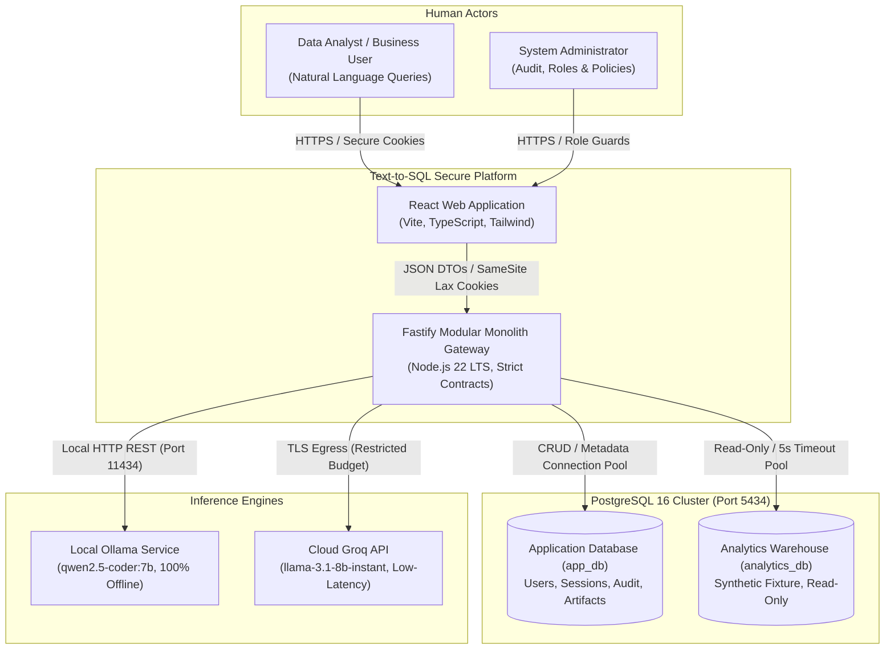
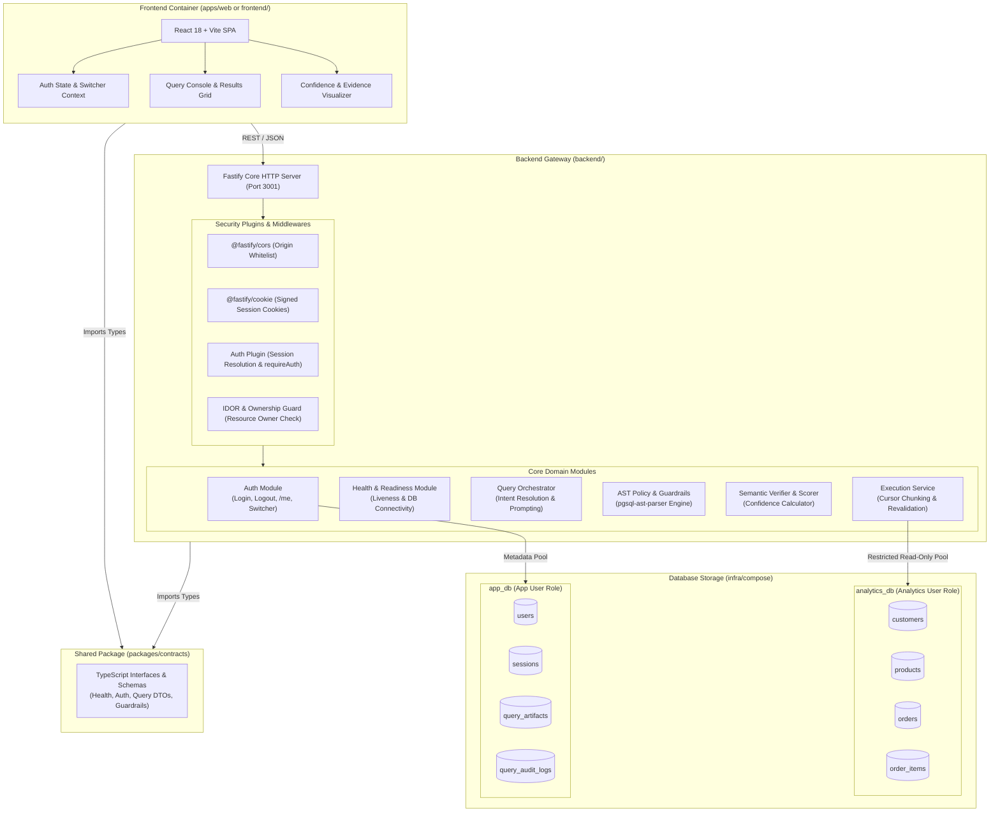
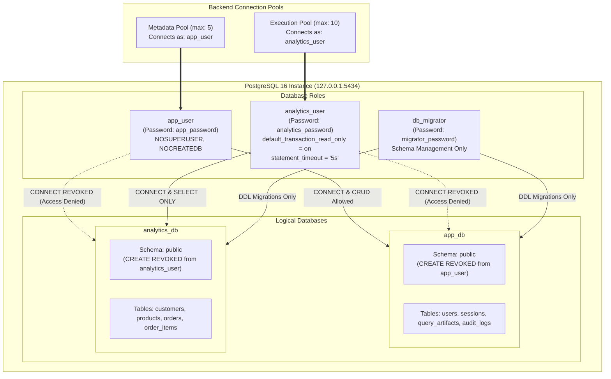
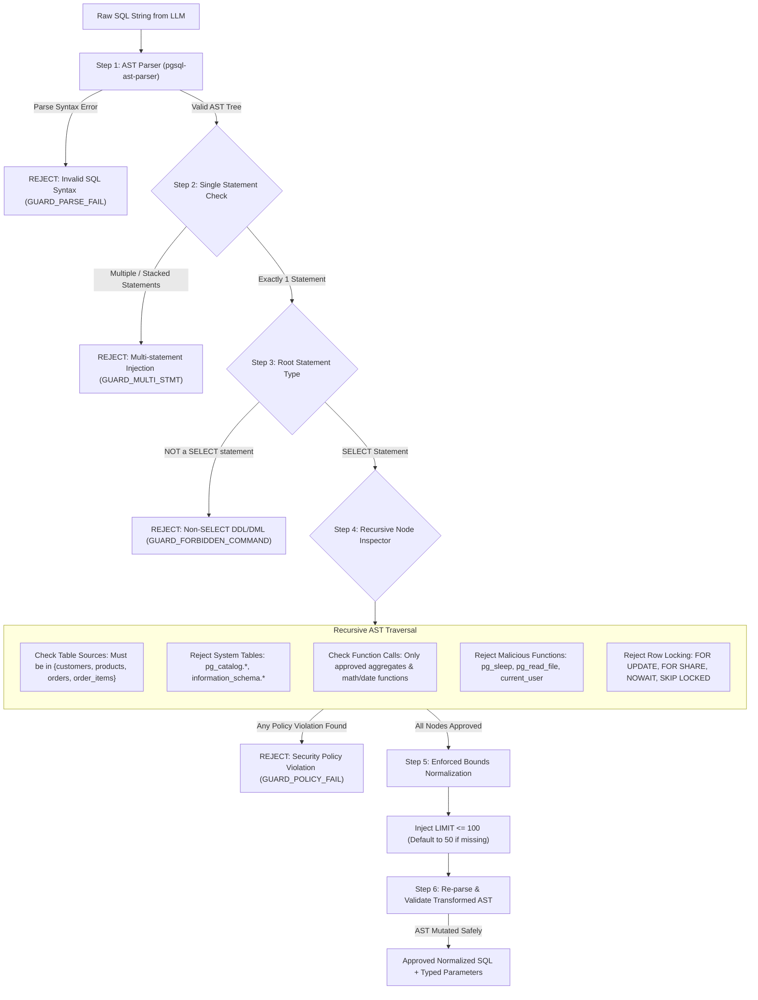
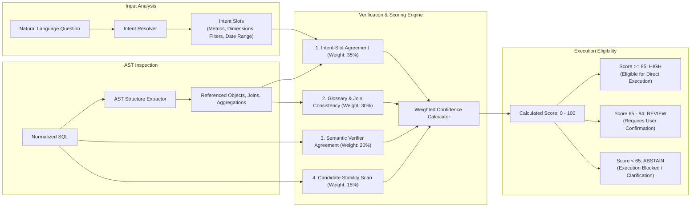
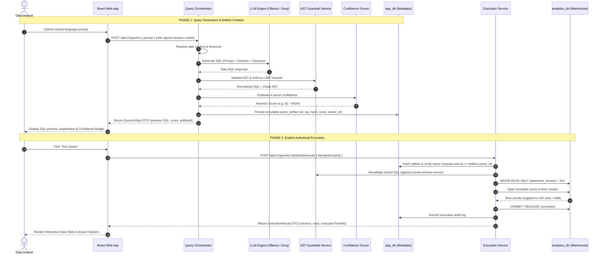
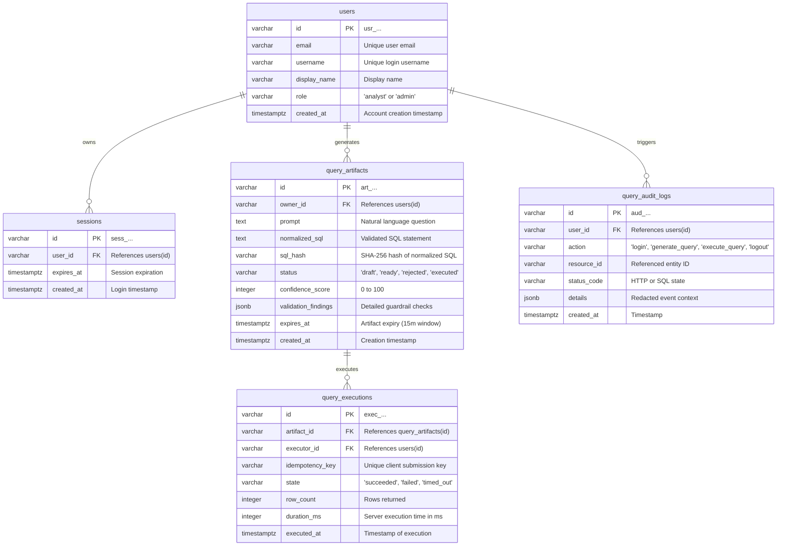
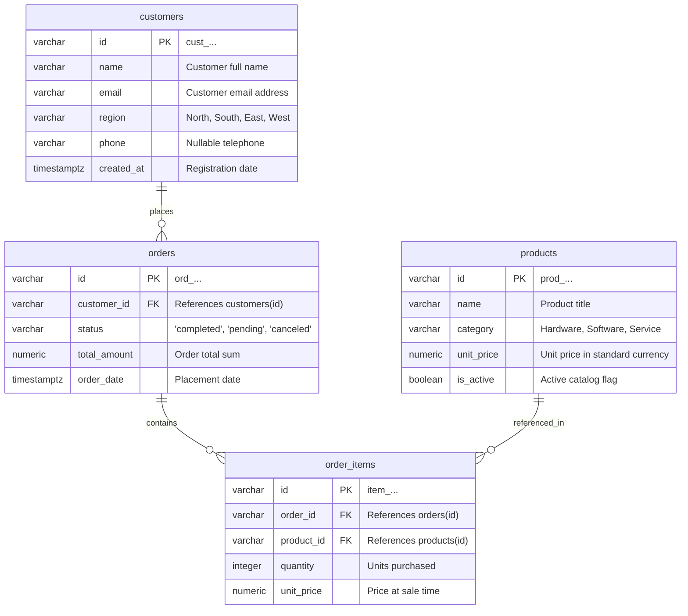
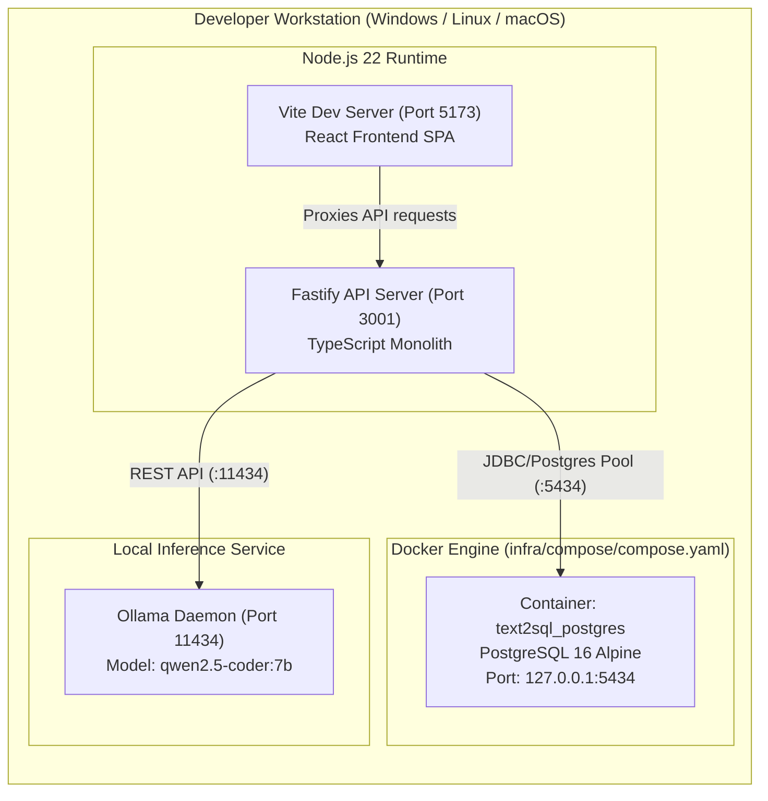
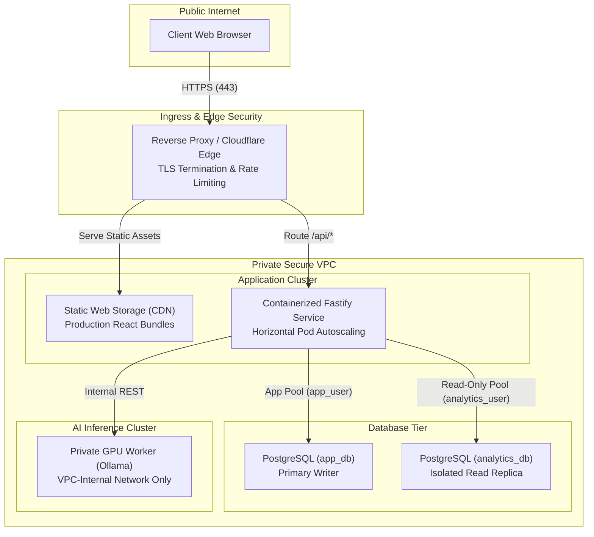

# Text-to-SQL Platform — Comprehensive System Architecture

- **Document Version:** 1.0.0
- **Status:** APPROVED & ACTIVE
- **Target Audience:** Systems Architects, Core Developers, Security Engineers, DevOps
- **Date:** 2026-10-16
- **Traceability:**
  - Sprint Plans: [Sprint 1](../sprint-1/README.md), [Sprint 2](../sprint-2/US-02-04.md)
  - Architecture Guide: [05-architecture.md](../planning/05-architecture.md)
  - ADRs: [ADR 01 (Core Stack)](../sprint-1/decisions/01-core-stack.md), [ADR 02 (AST Parser)](../sprint-1/decisions/02-ast-parser.md), [ADR 03 (Database Isolation)](../sprint-1/decisions/03-database-isolation.md), [ADR 04 (LLM Strategy)](../sprint-1/decisions/04-llm-provider-strategy.md)

---

## 1. Executive Summary & Architectural Vision

The **Text-to-SQL Interface** is a secure, enterprise-grade AI query assistant that translates natural language questions into safe, optimized PostgreSQL analytical queries. 

Unlike naive Text-to-SQL wrappers that pipe unvetted LLM output directly into database execution engines, this platform enforces a **zero-trust, multi-layered defense-in-depth architecture**:
1. **Zero Browser Privilege:** The client browser holds zero database credentials and zero LLM provider API keys.
2. **Deterministic AST Guardrails:** Every generated SQL string is parsed into an Abstract Syntax Tree (AST) using `pgsql-ast-parser` and evaluated against recursive deny-rules before execution is ever scheduled.
3. **Kernel-Level Database Isolation:** Analytical queries run exclusively as `analytics_user` with `default_transaction_read_only = on` and a kernel `statement_timeout = '5s'`. Application state (users, sessions, query artifacts) resides in an isolated logical database (`app_db`) managed by a distinct role (`app_user`).
4. **Hard Data Privacy Boundaries:** Zero database rows are transmitted to LLM providers. Prompts contain strictly allowlisted metadata, schema types, and approved glossary definitions.
5. **Two-Phase Artifact Workflow:** Query generation and query execution are decoupled. Generating a query creates an immutable, owned query artifact with transparent evidence scoring. Executing a query requires an explicit user command referencing the artifact ID, never raw client-supplied SQL.

---

## 2. High-Level Architecture (C4 Level 1 & Level 2)

### 2.1 System Context Diagram (C4 Level 1)

The system context illustrates the human actors, internal platform boundaries, and external integration points.



---

### 2.2 Container Architecture Diagram (C4 Level 2)

The platform is organized as a clean npm-workspace monorepo separating client presentation, shared typed contracts, and backend micro-modules.



---

## 3. Low-Level Architecture (C4 Level 3 — Component Breakdown)

### 3.1 Authentication, Identity & Session Subsystem

Authentication is built around server-side state in `app_db` paired with cryptographic cookie signing:
- **Cookie Security:** Cookies are stamped with `HttpOnly`, `SameSite=Lax`, `Path=/`, and signed using Fastify's secret (`SESSION_SECRET`).
- **Session Lifecycles:** Sessions persist with an `expires_at` timestamp. Expired sessions are rejected automatically during database resolution (`expires_at > CURRENT_TIMESTAMP`).
- **Identity Resolution:** On incoming requests, `authPlugin` unsigns the cookie, fetches `SessionWithUser` via `AuthRepository.findSessionById`, and decorates `request.user` and `request.sessionId`.
- **PreHandler Guard:** `requireAuth` immediately terminates unauthenticated calls with HTTP 401.

```mermaid
sequenceDiagram
    autonumber
    actor Analyst as Analyst (Browser)
    participant Fastify as Fastify Server
    participant Plugin as authPlugin (Hook)
    participant Repo as AuthRepository
    participant DB as app_db (PostgreSQL)

    Analyst->>Fastify: POST /api/auth/login { username: "analyst_a" }
    Fastify->>Repo: findUserByUsername("analyst_a")
    Repo->>DB: SELECT * FROM users WHERE username = $1
    DB-->>Repo: User record (id: "usr_analyst_a")
    Fastify->>Repo: createSession({ id: UUID, userId, expiresAt })
    Repo->>DB: INSERT INTO sessions VALUES ($1, $2, $3)
    DB-->>Repo: Session record
    Fastify-->>Analyst: HTTP 200 + Set-Cookie: session_id=<signed_token>; HttpOnly; SameSite=Lax

    Note over Analyst, Fastify: Subsequent Authenticated Request
    Analyst->>Fastify: GET /api/auth/me (Cookie: session_id=<signed_token>)
    Fastify->>Plugin: preHandler Hook
    Plugin->>Plugin: unsignCookie(rawCookie)
    Plugin->>Repo: findSessionById(sessionId)
    Repo->>DB: SELECT s.*, u.* FROM sessions s JOIN users u ... WHERE s.expires_at > NOW()
    DB-->>Repo: Valid Session + User
    Plugin->>Fastify: request.user = User, request.sessionId = SessionId
    Fastify-->>Analyst: HTTP 200 { user: { id, username, role, displayName } }
```

---

### 3.2 Dual-Database Isolation & Role Containment Architecture

Security is guaranteed at the PostgreSQL kernel level via distinct logical databases, users, and connection configurations:



#### Database Least-Privilege Matrix

| Operation | `app_user` on `app_db` | `app_user` on `analytics_db` | `analytics_user` on `analytics_db` | `analytics_user` on `app_db` |
| :--- | :---: | :---: | :---: | :---: |
| **CONNECT** | ✅ Granted | ❌ **DENIED** | ✅ Granted | ❌ **DENIED** |
| **SELECT** | ✅ Application metadata | ❌ Denied | ✅ Whitelisted analytics | ❌ Denied |
| **INSERT / UPDATE / DELETE** | ✅ Application metadata | ❌ Denied | ❌ **DENIED (Kernel 25006)** | ❌ Denied |
| **CREATE / DROP TABLE (DDL)**| ❌ **DENIED (SQLSTATE 42501)**| ❌ Denied | ❌ **DENIED (SQLSTATE 25006)** | ❌ Denied |
| **Query Timeout** | Standard | N/A | ⏱️ **Hard 5.00s (SQLSTATE 57014)** | N/A |

---

### 3.3 AST Guardrail & Safety Pipeline Architecture

The guardrail pipeline intercepts all raw SQL emitted by LLM adapters. It evaluates the query deterministically against safety rules:



#### Whitelist Specifications:
- **Allowlisted Relations:** `customers`, `products`, `orders`, `order_items`.
- **Allowlisted Aggregate Functions:** `COUNT()`, `SUM()`, `AVG()`, `MIN()`, `MAX()`.
- **Allowlisted Scalar Functions:** `DATE_TRUNC()`, `EXTRACT()`, `COALESCE()`, `ROUND()`, `LOWER()`, `UPPER()`.
- **Blacklisted Patterns:** `pg_sleep()`, `pg_read_file()`, `version()`, `SELECT INTO`, `COPY`, `UNION` with unapproved branches, subqueries containing DML.

---

### 3.4 Semantic Verification & Transparent Confidence Engine

Rather than relying on model self-confidence (which is notoriously uncalibrated), the platform evaluates query fidelity through a 4-vector deterministic scoring formula:



---

### 3.5 Two-Phase Query Lifecycle & Execution Flow

Execution is decoupled from generation to prevent unauthorized or automatic query firing.



---

## 4. Domain Data Model (Entity Relationship Diagram)

### 4.1 Application Database (`app_db`) Schema



---

### 4.2 Analytics Warehouse (`analytics_db`) Synthetic Schema



---

## 5. Security & Threat Mitigation Architecture

The system architecture addresses all primary attack vectors identified in the Sprint 1 Threat Model:

| Threat Vector | Potential Impact | Architectural Countermeasure |
| :--- | :--- | :--- |
| **SQL Injection via LLM** | Data destruction (`DROP TABLE`, `DELETE`, `TRUNCATE`) | **Multi-tier:** AST parser rejects non-SELECT ASTs; DB `analytics_user` has `default_transaction_read_only = on` and cannot execute writes (SQLSTATE 25006). |
| **Denial of Service (DoS)** | Database CPU lockup via `pg_sleep()` or Cartesian joins | **1.** AST parser bans `pg_sleep()`.<br/>**2.** Kernel enforces `statement_timeout = '5s'` (SQLSTATE 57014).<br/>**3.** Mandatory `LIMIT <= 100` injection. |
| **System Catalog Snooping** | Schema metadata exfiltration via `pg_catalog.*` | AST parser rejects all `pg_catalog`, `information_schema`, and `pg_toast` table identifiers. |
| **Cross-User Data Leaks (IDOR)** | Analyst A viewing or running Analyst B's queries | `ownership.guard.ts` verifies `request.user.id === artifact.owner_id`. Unauthorized requests fail closed with HTTP 404/403. |
| **Sensitive Data Egress** | Proprietary database records leaked to third-party LLM | **Zero data transmission:** Prompts contain strictly schema DDL structure, column types, and glossary metrics. Data records are never sent. |
| **Session Hijacking** | Impersonation of logged-in analysts | Fastify session cookies are cryptographically signed, `HttpOnly`, `SameSite=Lax`, and invalidated server-side upon logout. |

---

## 6. Infrastructure & Deployment Topology

### 6.1 Local Development Topology



### 6.2 Production Staging Topology



---

## 7. Architectural Decisions Summary

| ADR # | Topic | Decision | Core Rationale |
| :---: | :--- | :--- | :--- |
| **[ADR 01](../sprint-1/decisions/01-core-stack.md)** | Core Stack | **Fastify + React (Vite) + TS** | Unified TypeScript contracts, Fastify JSON validation speed, zero-overhead native Node 22 fetch. |
| **[ADR 02](../sprint-1/decisions/02-ast-parser.md)** | AST Parser | **`pgsql-ast-parser`** | Pure TypeScript AST validation, in-memory traversal (<5ms), zero WASM memory leaks, clean LIMIT injection. |
| **[ADR 03](../sprint-1/decisions/03-database-isolation.md)** | Database Isolation | **Two DBs + Least Privilege Roles** | Separation of `app_db` and `analytics_db`; hardware/kernel read-only enforcement and 5s query timeout. |
| **[ADR 04](../sprint-1/decisions/04-llm-provider-strategy.md)** | LLM Provider | **Ollama Local + Groq Cloud** | Ollama (`qwen2.5-coder:7b`) ensures 100% offline privacy; Groq (`llama-3.1-8b-instant`) provides optional ultra-fast acceleration under $5 budget. |
