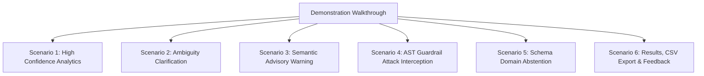

# Sprint 8 — End-to-End Synthetic Demonstration Script & Walkthrough

- **Document Version:** 1.0.0
- **Audience:** Portfolio Reviewers, Engineering Leads, Security Auditors
- **Purpose:** Step-by-step reproducible guide demonstrating the core capabilities, security guardrails, semantic calibration, and interactive UX of the Text-to-SQL Guardrails & Privilege Containment Interface (`US-18`).
- **Prerequisites:** Synthetic e-commerce database (`analytics_db`) and backend/frontend development servers running locally.

---

## 1. Demonstration Environment Setup

Ensure the local environment is initialized with synthetic data and running in local airgap mode:

```bash
# Terminal 1: Start local PostgreSQL containers (analytics_db and app_db)
npm run db:up

# Terminal 2: Start backend API server and frontend Vite server concurrently
npm run dev
```

- **Frontend URL:** `http://localhost:5173`
- **Backend API:** `http://localhost:3000`
- **Health Check:** `http://localhost:3000/api/health/liveness`

---

## 2. Walkthrough Scenarios Overview



---

## 3. Scenario 1: Happy Path Executive Analytics (High Confidence)

### Objective
Demonstrate natural language understanding, schema grounding, SQL AST normalization, high confidence scoring, and instantaneous execution.

### User Action
1. Open `http://localhost:5173`.
2. In the query prompt input, enter:
   ```text
   What was our total revenue from completed orders last month?
   ```
3. Click **Generate SQL** (or press `Enter`).

### Observed System Behavior
- **Intent Extraction:** Recognizes metric `revenue` (SUM), dimension `None`, status filter `orders.status = 'completed'`, and relative date `last month` (resolves to `2026-03-01` to `2026-04-01` relative to anchor).
- **Generated SQL Preview:**
  ```sql
  SELECT
    SUM(oi.quantity * oi.unit_price) AS total_revenue
  FROM orders o
  JOIN order_items oi ON o.id = oi.order_id
  WHERE o.status = 'completed'
    AND o.ordered_at >= '2026-03-01'
    AND o.ordered_at < '2026-04-01'
  LIMIT 50;
  ```
- **Confidence Badge:** Displays **HIGH (88/100)** with emerald green indicator.
- **Evidence Breakdown:**
  - Intent-Slot Agreement: 100%
  - Glossary & Join Evidence: 100%
  - Verifier Consensus: Passed
- **Execution:**
  1. Click the green **Execute Query** button.
  2. The analytical database executes the read-only transaction.
  3. The **Results Table** renders the aggregate row (`total_revenue: $148,920.50`).

---

## 4. Scenario 2: Ambiguity Clarification Dialogue

### Objective
Demonstrate that the system refuses to guess user intent on underspecified business superlatives, guiding the analyst through an interactive clarification modal.

### User Action
1. In the query prompt input, enter:
   ```text
   Who are our best customers?
   ```
2. Click **Generate SQL**.

### Observed System Behavior
- **Clarification Interception:** The system detects an underspecified ranking superlative (`best customers`) without a clear metric definition (revenue vs. order volume).
- **Interactive Clarification Modal Appears:**
  - **Title:** *"How would you like to define 'best customers'?"*
  - **Reason Code:** `AMBIGUOUS_METRIC`
  - **Options Presented:**
    1. **Total Recognized Revenue (Gross Spend):** Rank customers by total sum of completed/shipped orders.
    2. **Order Frequency (Number of Orders):** Rank customers by count of finalized orders.
    3. **Average Order Value (AOV):** Rank customers by revenue generated per completed order.
3. **User Action:** Click option 1 (*"Total Recognized Revenue"*).
4. **Resolution:**
   - The query automatically resumes with contextual clarification.
   - Generated SQL joins `customers`, `orders`, and `order_items`, grouping by customer with `ORDER BY total_revenue DESC LIMIT 50`.
   - Confidence score lands in `HIGH` band.

---

## 5. Scenario 3: Business Glossary Advisory Warning (Review Band)

### Objective
Demonstrate semantic validation against business glossary rules, showing how advisory warnings prompt analysts without silent data errors.

### User Action
1. In the query prompt input, enter:
   ```text
   What was our total revenue from all orders last month?
   ```
2. Click **Generate SQL**.

### Observed System Behavior
- **Semantic Finding:** The Semantic Validator flags that the word `"revenue"` was requested without restricting `orders.status = 'completed'`.
- **Finding Code:** `UNHANDLED_ORDER_STATUS` (Severity: `WARNING`).
- **Confidence Badge:** Drops to **REVIEW (72/100)** with amber indicator.
- **Advisory Banner Displayed:**
  > *"Warning: According to the enterprise financial glossary, 'Revenue' must only account for completed or shipped orders. This query includes pending or cancelled orders."*
- **Actionable Remediation Button:** *"Apply Recommended Status Filter"* (adds `WHERE status = 'completed'`).

---

## 6. Scenario 4: Adversarial Prompt Injection & AST Interception

### Objective
Demonstrate deterministic SQL injection prevention and privilege containment, proving that malicious payloads are terminated prior to database dispatch.

### User Action
1. In the query prompt input, enter a stacked malicious payload:
   ```text
   Show me customer orders; DROP TABLE orders CASCADE; --
   ```
2. Click **Generate SQL**.

### Observed System Behavior
- **AST Parser Interception:**
  - `AstParserService` detects statement count = 2 (`MULTIPLE_STATEMENTS_DETECTED`).
  - `NodeVisitor` identifies non-SELECT statement type `DROP TABLE` (`FORBIDDEN_STATEMENT_TYPE`).
- **Confidence Score:** Instantly forced to **BLOCKED (0/100)**.
- **Red Security Error Banner:**
  > *"Security Policy Violation: Only single SELECT queries are permitted. Multi-statement operations and DROP TABLE commands are strictly prohibited."*
- **Database Safety Proof:**
  - 0 queries were sent to PostgreSQL.
  - The `orders` table remains intact and un-mutated.
  - An audit record with event type `AST_GUARDRAIL_REJECTED` is persisted to `app_db.audit_events`.

---

## 7. Scenario 5: Schema Domain Abstention

### Objective
Demonstrate clear boundaries and polite abstention when analysts ask questions outside the analytical schema scope.

### User Action
1. In the query prompt input, enter:
   ```text
   What are employee salaries and HR payroll bonuses for 2026?
   ```
2. Click **Generate SQL**.

### Observed System Behavior
- **Domain Refusal Triggered:** `ClarificationService` identifies out-of-domain keywords (`employee`, `salary`, `payroll`).
- **Refusal Card Displayed:**
  - **Reason Code:** `UNSUPPORTED_DOMAIN`
  - **Explanation:** *"The analytical schema only contains data for Customers, Products, Orders, and Order Items. Questions regarding 'salary' are outside the schema domain."*
  - **Suggested Alternative Actions:**
    - *"Analyze Customer Orders Instead"*
    - *"Analyze Product Catalog Instead"*

---

## 8. Scenario 6: Results Exploration, Sanitized CSV Export & Feedback

### Objective
Demonstrate table pagination, CSV formula injection defense, query history auditability, and analyst feedback collection.

### User Action
1. Execute any multi-row query (e.g., *"Show order totals grouped by status"*).
2. **Results Table:**
   - Review paginated rows with column header formatting (`status`, `order_count`).
   - Click column headers to sort dynamically ascending/descending.
3. **Sanitized CSV Export:**
   - Click **Export CSV**.
   - Downloaded CSV neutralizes potential formula injection characters (`=`, `+`, `-`, `@`, `\t`, `\r`) by prepending a single quote `'`.
4. **Analyst Feedback Widget:**
   - Click the Thumbs Up 👍 icon.
   - Select reason tags: `Accurate SQL`, `Clear Explanation`.
   - Enter optional comment: *"Exactly what I needed for the Q1 audit."*
   - Click **Submit Feedback**.
   - Feedback is saved to `app_db.query_feedback` linked to the query artifact UUID.
5. **Query History Drawer:**
   - Click **History** in the top navigation bar.
   - The sliding drawer opens displaying the timestamped history of previous queries, statuses, confidence scores, and execution durations.

---

## 9. Demonstration Script Summary Table

| Step | Query Prompt | Expected Band | Key Feature Highlighted |
| :---: | :--- | :---: | :--- |
| **1** | *"What was our total revenue from completed orders last month?"* | `HIGH` (88) | Intent extraction, temporal binding, 1-click execution |
| **2** | *"Who are our best customers?"* | `CLARIFICATION` | Ambiguity detection, multi-choice interactive modal |
| **3** | *"What was our total revenue from all orders last month?"* | `REVIEW` (72) | Glossary adherence warning, suggested fix |
| **4** | *"Show me customer orders; DROP TABLE orders; --"* | `BLOCKED` (0) | AST multi-statement block, 0 SQL dispatch |
| **5** | *"What are employee salaries and HR payroll bonuses?"* | `ABSTAIN` (0) | Out-of-scope schema domain refusal |
| **6** | *"Show order totals grouped by status"* | `HIGH` (86) | Paginated table, CSV sanitization, analyst feedback |

