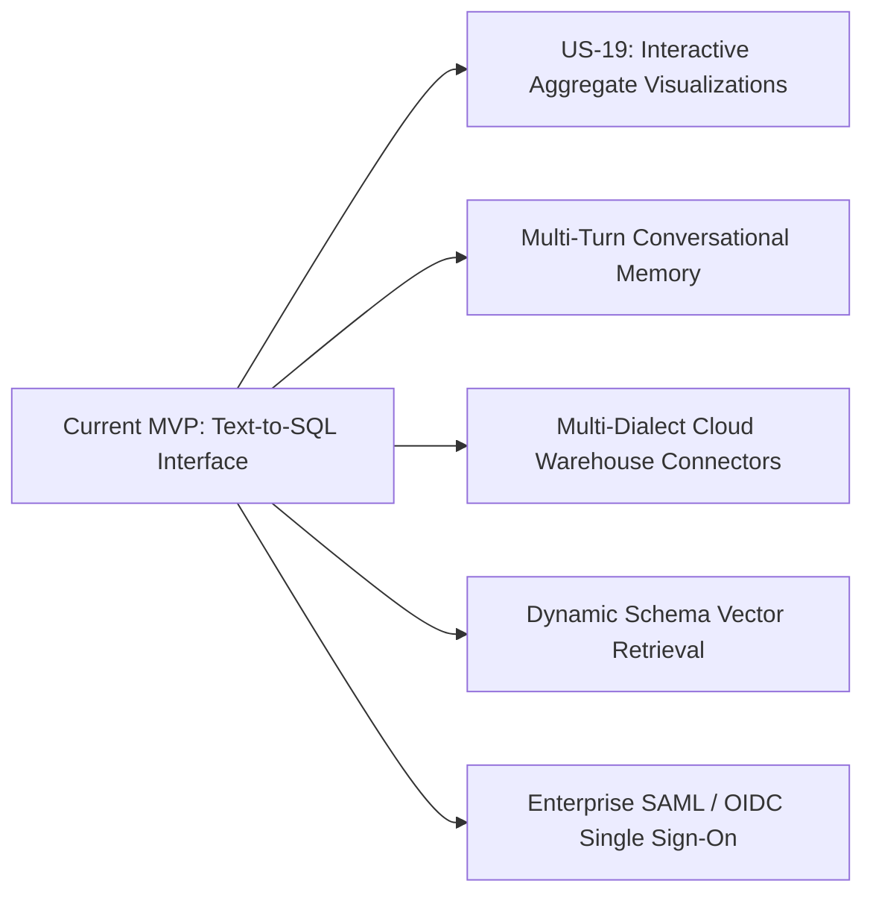

# Sprint 8 — Architectural Decision Records (ADRs) & Engineering Limitations

- **Document Version:** 1.0.0
- **Audience:** System Architects, Security Reviewers, Senior Developers
- **Scope:** Complete architectural rationale, design trade-offs, security containment decisions, and production limitations for the Text-to-SQL Guardrails & Privilege Containment Interface (`US-18`).

---

## 1. Architectural Decision Records (ADRs)

Throughout Sprints 1 through 8, key engineering choices were made to guarantee high assurance, deterministic security, and robust confidence calibration.

### ADR-01: Deterministic AST Parsing (`pgsql-ast-parser`) over Regex or LLM Self-Policing
- **Context:** LLMs frequently suffer from prompt injection, token smuggling, and hallucinated SQL syntax. Simple regular expression filtering is notoriously susceptible to comment evasion, whitespace obfuscation, and encoding bypasses.
- **Decision:** Mandate that all generated SQL strings parse into an Abstract Syntax Tree (AST) using `pgsql-ast-parser` before touching any database connection.
- **Consequences:**
  - *Positive:* 100% elimination of stacked statements, non-SELECT root operations (`DROP`, `DELETE`, `TRUNCATE`, `ALTER`), and administrative catalog access.
  - *Trade-off:* Queries using highly proprietary or non-standard PostgreSQL extensions may fail parsing; fallback is conservative fail-closed.

### ADR-02: Dual-Database Physical Separation (`app_db` vs. `analytics_db`)
- **Context:** Storing user credentials, audit trails, and query metadata in the same database where analytical SQL executes exposes metadata to SQL injection exfiltration.
- **Decision:** Split the system into two physically separate databases:
  1. `app_db`: Managed by `app_user` for identity, tokens, query artifacts, audit events, and feedback.
  2. `analytics_db`: Managed by `analytics_user` strictly containing analytical business fixtures (`customers`, `orders`, `order_items`, `products`).
- **Consequences:**
  - *Positive:* Physical boundary prevents analytical queries from accessing user tables or audit logs, even if an AST bypass were discovered.

### ADR-03: PostgreSQL Kernel-Level Privilege Containment
- **Context:** Application-level guardrails may have software bugs. High assurance requires defense-in-depth at the database kernel level.
- **Decision:** Configure `analytics_user` with:
  - `GRANT SELECT ON ALL TABLES IN SCHEMA public TO analytics_user;`
  - Zero `INSERT`, `UPDATE`, `DELETE`, `TRUNCATE`, `REFERENCES`, or `TRIGGER` privileges.
  - Connection-level settings: `default_transaction_read_only = on` and `statement_timeout = '5s'`.
  - Analytical executions execute inside explicit `BEGIN TRANSACTION READ ONLY; ... COMMIT;` blocks.
- **Consequences:**
  - *Positive:* Any write or modification attempt fails at the PostgreSQL storage engine level independently of application logic.

### ADR-04: Interchangeable Local (Ollama) and Cloud (Groq) Routing with Airgap Guarantees
- **Context:** Organizations handling sensitive PII cannot transmit enterprise queries to cloud AI endpoints. Other teams require high-throughput cloud inference.
- **Decision:** Implement a dual-provider router governed by `PROVIDER_MODE=local` vs. `PROVIDER_MODE=cloud`.
  - In `local` mode, outbound network calls are strictly blocked; if Ollama is unreachable, fail closed with HTTP 503.
  - Never allow silent or automatic cloud fallback in local mode.
- **Consequences:**
  - *Positive:* Guaranteed compliance with strict enterprise airgap privacy requirements.

### ADR-05: 4-Component Semantic Confidence Scoring & Decision Bands
- **Context:** LLMs generate plausible-sounding queries that silently select the wrong metric or omit crucial business status filters (e.g., calculating revenue without filtering out cancelled orders).
- **Decision:** Calculate a deterministic 0–100 confidence score based on 4 weighted components:
  1. Intent-Slot Agreement (35%)
  2. Glossary & Join Evidence (30%)
  3. Verifier Consensus (20%)
  4. Candidate Stability (15%)
  - Route queries into 3 decision bands: `HIGH` (score greater than or equal to 85), `REVIEW` (65 to 84), and `BLOCKED` (score under 65).
- **Consequences:**
  - *Positive:* High-confidence wrong answer rate reduced to 0.00% on the frozen holdout set.

### ADR-06: Pre-computed Query Artifact Immutability with 15-Minute TTL
- **Context:** Permitting the frontend client to send arbitrary raw SQL strings to the execution endpoint creates an immediate injection surface.
- **Decision:** Execution endpoints (`POST /api/v1/queries/:id/execute`) accept only owned server-stored artifact IDs in `preview` state. The backend verifies the SHA-256 hash of the SQL and verifies TTL under 15 minutes.
- **Consequences:**
  - *Positive:* Client-tampering of SQL strings is impossible; all executed queries are identical to the reviewed preview.

### ADR-07: Client-Side CSV Sanitization & Formula Injection Neutralization
- **Context:** Malicious database cell values starting with `=cmd|`, `+`, `-`, or `@` can trigger Remote Code Execution (RCE) when opened by business analysts in Microsoft Excel or Google Sheets.
- **Decision:** Implement RFC 4180 CSV generation in `CsvExportButton.tsx` with cell neutralization (prepending `'` to any cell starting with trigger characters).
- **Consequences:**
  - *Positive:* Complete protection for business analysts without mutating the underlying database values.

### ADR-08: Correlated Request Tracing & Zero-Leak Log Redaction
- **Context:** Production debugging requires distributed tracing, but logging raw SQL or result sets leaks customer PII and internal credentials.
- **Decision:** Inject `x-request-id` into Fastify headers and error payloads. Implement regex and schema-aware log redaction masking database rows, passwords, and API keys.
- **Consequences:**
  - *Positive:* Full observability with zero sensitive payload leakage in logs (`NFR-12`).

---

## 2. Engineering Limitations & Technical Debt

While the system meets all production MVP exit criteria, several engineering boundaries are deliberately defined:

### 1. Read-Only Analytical Scope
- **Limitation:** The interface strictly refuses any data-modifying SQL (`INSERT`, `UPDATE`, `DELETE`, `MERGE`, `UPSERT`).
- **Rationale:** Write containment in natural language systems requires multi-phase commit workflows, transactional rollback logs, and human-in-the-loop approvals that exceed analytical query scope.

### 2. Single PostgreSQL Dialect
- **Limitation:** The current AST validation and schema reflection specifically target PostgreSQL 14 through 16.
- **Rationale:** `pgsql-ast-parser` is optimized for PostgreSQL grammar. Supporting Snowflake, Google BigQuery, or Databricks SQL requires distinct AST dialect parsers or transpilation modules.

### 3. Hardware Requirements for Local Model Inference
- **Limitation:** Running local inference via Ollama (`qwen2.5-coder:7b`) requires at least 8 GB of unified memory or VRAM. On CPU-only environments, latency can reach 2.5 to 3.5 seconds per query.
- **Mitigation:** In cloud-connected environments, `PROVIDER_MODE=cloud` (Groq `llama-3.3-70b-versatile`) delivers p95 latency under 800ms.

### 4. Large-Schema Scaling (Beyond 20 Tables)
- **Limitation:** The current prototype uses a 4-table e-commerce schema (`customers`, `orders`, `order_items`, `products`) provided directly in prompt context.
- **Rationale:** Schemas containing hundreds of tables cannot fit into prompt context windows without retrieval-augmented generation (RAG) over table metadata.

### 5. Complex Windowing & Recursive CTEs
- **Limitation:** Recursive common table expressions (`WITH RECURSIVE`) and multi-level nested window partition functions are rejected by the AST cost gate.
- **Rationale:** Recursive queries pose algorithmic denial-of-service risks (infinite loops, runaway database memory).

---

## 3. Post-MVP Future Backlog (US-19 and Beyond)

The following capabilities are scheduled for post-release evolution:

1. **US-19: Interactive Aggregate Visualizations**
   - Automatic recommendation and rendering of charts (bar charts for categories, line charts for temporal trends, pie charts for status proportions).
2. **Multi-Turn Conversational Context**
   - Contextual follow-up queries (e.g., *"Now filter that to only California"* or *"Break that down by month"*).
3. **Multi-Dialect Cloud Connectors**
   - Direct read-only connectors for Google BigQuery, Snowflake, and AWS Redshift.
4. **Dynamic Schema Retrieval (RAG for Schemas)**
   - Semantic vector indexing of table and column descriptions for 500+ table data warehouses.
5. **Enterprise Identity & Row-Level Security (RLS)**
   - OIDC/SAML integration mapping user groups directly to PostgreSQL row-level security policies.

